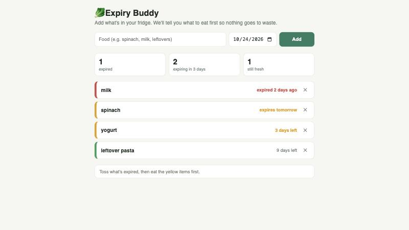

# 🥬 Expiry Buddy

A tiny web app that tells you what to eat first so food doesn't go to waste.

Add what's in your fridge with its expiry date. Expiry Buddy sorts everything by urgency, colors it red (expired), yellow (3 days or less) or green (fresh), shows the counts at a glance, and gives you one plain-English tip: what to eat next.

Built for NextSpark Hacks 2026.

## The problem

Households throw away a large share of the food they buy, and most of it is things that quietly expired at the back of the fridge. Existing apps want you to scan barcodes, create accounts, or manage full inventories, so nobody keeps using them. The fix needs to be faster than the problem: type a name, pick a date, done.

## Run it

No build, no install, no account.

- Open `index.html` in any browser, or
- serve the folder: `python3 -m http.server 8000` and open http://localhost:8000/

Your list is saved in your browser's localStorage and never leaves your device.

## How it's built

One HTML file. Vanilla JavaScript, CSS with light and dark mode via `prefers-color-scheme`, no dependencies. Items are stored as `{ name, date }` in localStorage, sorted by date on every render, and bucketed by days left: `< 0` expired, `<= 3` soon, otherwise fresh.

## Credits

- Written by Shivani Chauhan.
- Claude Code (Anthropic) was used to scaffold the page and draft the README.
- No external libraries or assets.

## License

MIT
